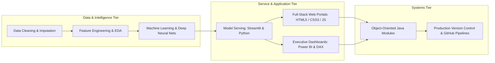

<div align="center">


[](https://www.python.org/)
[](https://www.java.com/)
[](https://pytorch.org/)
[](https://www.tensorflow.org/)
[](https://streamlit.io/)
[](https://powerbi.microsoft.com/)
[](https://www.alliance.edu.in/)

</div>

---

## 📌 Executive Summary / Overview

Hello and welcome! I am **Jeshwanthika Pothamchetty**, a passionate Software Engineer and Computer Applications Scholar at Alliance University, Bengaluru. My engineering focus centers on developing trustworthy Artificial Intelligence, building responsive full-stack web architectures, and delivering insightful business intelligence reporting.

Across this GitHub profile, you will find active codebases spanning:
- **Artificial Intelligence & Generative Deep Learning**: Auditing demographic bias in pretrained transformer models (`distilgpt2`), synthesizing apparel images via Deep Convolutional GANs (DCGAN), and experimenting with StyleGAN2-ADA latent manifolds.
- **Full-Stack Web Engineering**: Modern user-facing web portals (City Hospital, Food Cafe, Rapido transit clone, and glassmorphic academic grading calculators).
- **Applied Data Science & Machine Learning**: Diagnostic clinical prediction (Pima Indians Diabetes classification) and 50+ cell econometric real estate price modeling pipelines.
- **Object-Oriented Software Systems**: Modular Java architectures implementing SOLID Single Responsibility Principles, card dealer engines, and asset inventory controls.

---

## 📖 Interactive Table of Contents

- [Executive Summary / Overview](#-executive-summary--overview)
- [Key Features & Capabilities](#-key-features--capabilities)
- [System Architecture & Engineering Philosophy](#-system-architecture--engineering-philosophy)
- [Tech Stack Breakdown](#-tech-stack-breakdown)
- [Featured Repositories & Flagship Projects](#-featured-repositories--flagship-projects)
- [Reproducible Quickstart & Setup](#-reproducible-quickstart--setup)
- [Project Directory Layout](#-project-directory-layout)
- [Author & Connect](#-author--connect)

---

## ✨ Key Features & Capabilities

- **Ethical AI & NLP Auditing**: Quantifying and mitigating stereotypical bias in language generation pipelines through counterfactual prompt analysis.
- **Generative Computer Vision**: Implementing minimax adversarial loss dynamics in TensorFlow and PyTorch for synthetic image synthesis.
- **Full-Stack Visual Craftsmanship**: Designing responsive, accessible digital experiences leveraging modern glassmorphism, responsive grid layouts, and clean DOM manipulation.
- **Statistically Disciplined Analytics**: Enforcing rigorous data sanitation, physiological zero-value treatment, and stratified cross-validation.
- **Clean Object-Oriented Engineering**: Applying design patterns, encapsulation, and unit-tested separation of concerns in Java.

---

## 🏗️ System Architecture & Engineering Philosophy



---

## 🛠️ Tech Stack Breakdown

| Category | Technologies & Tools |
| :--- | :--- |
| **Programming Languages** | Python 3.9+, Java (JDK 11, 17, 21), SQL, JavaScript, HTML5, CSS3 |
| **AI, Deep Learning & NLP** | PyTorch, TensorFlow, Keras, Hugging Face Transformers, StyleGAN2-ADA |
| **Data Science & Analytics** | Pandas, NumPy, Scikit-Learn, SciPy, Matplotlib, Seaborn |
| **Business Intelligence** | Microsoft Power BI Desktop, DAX, Power Query ETL |
| **Web & App Development** | Streamlit, Glassmorphic CSS, Flexbox/Grid, Responsive Web Design |
| **Developer Tools** | Git, GitHub CLI, JupyterLab, Visual Studio Code, IntelliJ IDEA |

---

## 🌟 Featured Repositories & Flagship Projects

| Flagship Repository | Domain | Description & Key Impact |
| :--- | :--- | :--- |
| **[bias-detector-project](https://github.com/Jeshwanthika07/bias-detector-project)** | Generative AI & NLP | Streamlit web application detecting demographic bias in DistilGPT-2 with tone delta metrics |
| **[AI_Assignment-1](https://github.com/Jeshwanthika07/AI_Assignment-1)** | Deep Generative Vision | DCGAN synthesis on Fashion-MNIST and StyleGAN2-ADA latent space exploration |
| **[DL-Assignments](https://github.com/Jeshwanthika07/DL-Assignments)** | Deep Learning Research | Comparative benchmark of FNN, CNN, and RNN architectures and non-linear activation dynamics |
| **[PIIMS-Indians-Diabetics](https://github.com/Jeshwanthika07/PIIMS-Indians-Diabetics)** | Clinical Data Science | Predictive machine learning classification diagnosing Type-2 diabetes onset |
| **[IDS-SDS](https://github.com/Jeshwanthika07/IDS-SDS)** | Econometric Modeling | 52-cell statistical real estate valuation & hedonic house pricing pipeline |
| **[BA-Experiment-4](https://github.com/Jeshwanthika07/BA-Experiment-4)** | Business Intelligence | Enterprise Power BI dashboard featuring Star Schema modeling and custom DAX measures |
| **[cardgame-repo](https://github.com/Jeshwanthika07/cardgame-repo)** | Object-Oriented Java | Modular 52-card dealer simulation utilizing LIFO Stack collections |

---

## 🚀 Reproducible Quickstart & Setup

### Clone Any Repository
```bash
# Clone the master profile showcase
git clone https://github.com/Jeshwanthika07/Jeshwanthika07.git
cd Jeshwanthika07

# Clone any specific project (e.g., Bias Detector)
git clone https://github.com/Jeshwanthika07/bias-detector-project.git
```

---

## 📂 Project Directory Layout

```text
Jeshwanthika07/
│
├── README.md                  # Official GitHub profile README and portfolio showcase
└── LICENSE                    # Open-source MIT license
```

---

## 👩‍💻 Author & Connect

**Jeshwanthika Pothamchetty**  
*Bachelor of Computer Applications (Hons) | Department of Computer Applications, Alliance University*  
- **GitHub Profile**: [@Jeshwanthika07](https://github.com/Jeshwanthika07)  
- **Email Contact**: [pjeshwanthika9@gmail.com](mailto:pjeshwanthika9@gmail.com)

<div align="center">


</div>
