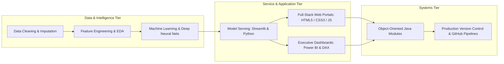

<p align="center">
  
</p>

<p align="center">
  <a href="https://www.python.org/"></a>
  <a href="https://www.java.com/"></a>
  <a href="https://pytorch.org/"></a>
  <a href="https://www.tensorflow.org/"></a>
  <a href="https://streamlit.io/"></a>
  <a href="https://powerbi.microsoft.com/"></a>
  <a href="https://www.alliance.edu.in/"></a>
</p>

---

## 📌 Executive Summary / Overview

Hello and welcome! I am **Jeshwanthika Pothamchetty**, a passionate Software Engineer and Computer Applications Scholar at Alliance University, Bengaluru. My engineering focus centers on developing trustworthy Artificial Intelligence, building responsive full-stack web architectures, and delivering insightful business intelligence reporting.

Across this GitHub profile, you will find active codebases spanning:
- **Artificial Intelligence & Generative Deep Learning**: Auditing demographic bias in pretrained transformer models (`distilgpt2`), synthesizing apparel images via Deep Convolutional GANs (DCGAN), and experimenting with StyleGAN2-ADA latent manifolds.
- **Full-Stack Web Engineering**: Modern user-facing web portals (City Hospital, Food Cafe, Rapido transit clone, and glassmorphic academic grading calculators).
- **Applied Data Science & Machine Learning**: Diagnostic clinical prediction (Pima Indians Diabetes classification) and 50+ cell econometric real estate price modeling pipelines.
- **Object-Oriented Software Systems**: Modular Java architectures implementing SOLID Single Responsibility Principles, card dealer engines, and asset inventory controls.

---

## 📖 Interactive Table of Contents

- [Executive Summary / Overview](#-executive-summary--overview)
- [Key Features & Capabilities](#-key-features--capabilities)
- [System Architecture & Engineering Philosophy](#-system-architecture--engineering-philosophy)
- [Featured Projects & Source Code Directory](#-featured-projects--source-code-directory)
  - [1. Artificial Intelligence & Deep Learning](#1-artificial-intelligence--deep-learning)
  - [2. Business Intelligence & Analytics](#2-business-intelligence--analytics)
  - [3. Clinical Data Science & Econometrics](#3-clinical-data-science--econometrics)
  - [4. Full-Stack Web Applications](#4-full-stack-web-applications)
  - [5. Object-Oriented Java Systems](#5-object-oriented-java-systems)
  - [6. Python Problem Solving & Modules](#6-python-problem-solving--modules)
- [Tech Stack Breakdown](#-tech-stack-breakdown)
- [Reproducible Quickstart & Setup](#-reproducible-quickstart--setup)
- [Project Directory Layout](#-project-directory-layout)
- [Author & Connect](#-author--connect)

---

## ✨ Key Features & Capabilities

- **Ethical AI & NLP Auditing**: Quantifying and mitigating stereotypical bias in language generation pipelines through counterfactual prompt analysis.
- **Generative Computer Vision**: Implementing minimax adversarial loss dynamics in TensorFlow and PyTorch for synthetic image synthesis.
- **Full-Stack Visual Craftsmanship**: Designing responsive, accessible digital experiences leveraging modern glassmorphism, responsive grid layouts, and clean DOM manipulation.
- **Statistically Disciplined Analytics**: Enforcing rigorous data sanitation, physiological zero-value treatment, and stratified cross-validation.
- **Clean Object-Oriented Engineering**: Applying design patterns, encapsulation, and unit-tested separation of concerns in Java.

---

## 🏗️ System Architecture & Engineering Philosophy



---

## 🌟 Featured Projects & Source Code Directory

Direct links to the source code, architecture, and documentation for each project across my GitHub profile:

### 1. Artificial Intelligence & Deep Learning

| Project | Tech Stack | Description | Source Code Link |
|:---|:---|:---|:---:|
| **Bias Detector Project** | Python, Streamlit, Hugging Face, PyTorch | Evaluates and visualizes demographic bias in DistilGPT-2 via counterfactual prompts and tone delta metrics | [](https://github.com/Jeshwanthika07/bias-detector-project) |
| **AI Generative & DCGAN Suite** | TensorFlow, Keras, StyleGAN2-ADA, PyTorch | DCGAN synthesis on Fashion-MNIST and NVIDIA StyleGAN2-ADA FFHQ latent space exploration | [](https://github.com/Jeshwanthika07/AI_Assignment-1) |
| **Deep Learning Research Lab** | Python, NumPy, Matplotlib, Neural Calculus | Comparative study of FNN, CNN, and RNN paradigms and non-linear activation dynamics | [](https://github.com/Jeshwanthika07/DL-Assignments) |

### 2. Business Intelligence & Analytics

| Project | Tech Stack | Description | Source Code Link |
|:---|:---|:---|:---:|
| **BA Dashboard IV** | Power BI, DAX, Power Query M | Enterprise KPI modeling, Star Schema data models, and YoY variance tracking | [](https://github.com/Jeshwanthika07/BA-Experiment-4) |
| **BA Dashboard II** | Power BI, DAX Measures | Financial and operational diagnostic dashboards with interactive drill-down matrices | [](https://github.com/Jeshwanthika07/Business-Analytics-Exp-2) |
| **Retail DB Analytics** | Power BI, SQL, Technical Report PDF | Omnichannel retail database analysis, customer demographics, and merchandising report | [](https://github.com/Jeshwanthika07/Business-Analayis-Projects) |

### 3. Clinical Data Science & Econometrics

| Project | Tech Stack | Description | Source Code Link |
|:---|:---|:---|:---:|
| **Pima Diabetes Predictor** | Python, Scikit-Learn, Pandas | Supervised machine learning diagnostic classifier predicting diabetes onset | [](https://github.com/Jeshwanthika07/PIIMS-Indians-Diabetics) |
| **Real Estate Valuation Pipeline** | Python, Scikit-Learn, Seaborn, Pandas | 52-cell hedonic housing price prediction and statistical econometrics framework | [](https://github.com/Jeshwanthika07/IDS-SDS) |
| **Titanic Survival EDA** | Python, Pandas, Seaborn, Matplotlib | Empirical statistical survival analysis, demographic cross-tabulation, and missing imputation | [](https://github.com/Jeshwanthika07/personals) |
| **Applied Data Science Lab** | Python, Scikit-Learn, NumPy, Pipelines | Empirical data science research, feature normalization, and model cross-validation | [](https://github.com/Jeshwanthika07/DATA-SCIENCE-) |
| **Data Science Ecosystem** | Python, Pandas, Data Mining | Predictive modeling, exploratory data analysis, and statistical hypothesis testing | [](https://github.com/Jeshwanthika07/DATA-SCIENCE) |

### 4. Full-Stack Web Applications

| Project | Tech Stack | Description | Source Code Link |
|:---|:---|:---|:---:|
| **City Hospital Healthcare Portal** | HTML5, CSS3, Responsive Design | Clinical department directory, emergency helplines, and appointment booking UI | [](https://github.com/Jeshwanthika07/FSD_CityHospital) |
| **Food Cafe Hospitality Interface** | HTML5, CSS3, Flexbox, RGBA Glass | Atmospheric dining interface featuring culinary menus and online table reservation | [](https://github.com/Jeshwanthika07/FSD_FoodCafe) |
| **Rapido FSD Transit Portal** | HTML5, CSS3, Geolocation Forms | Multi-modal ride-hailing interface featuring Bike, Auto, Cab, and Parcel selection | [](https://github.com/Jeshwanthika07/Rapido_FSD) |
| **Student Grading System** | HTML5, Glassmorphism CSS, Vanilla JS | Interactive academic GPA and grade calculator with complete mini-project report | [](https://github.com/Jeshwanthika07/FSD_PothamchettyJeswanthika) |
| **Parallelism Portfolio** | HTML5, SASS / SCSS, jQuery PopTrox | Cinematic horizontally scrolling creative portfolio with lightbox modal zoom | [](https://github.com/Jeshwanthika07/Portfolio_Template) |

### 5. Object-Oriented Java Systems

| Project | Tech Stack | Description | Source Code Link |
|:---|:---|:---|:---:|
| **Card Game Deck Simulator** | Java JDK 17, Collections, LIFO Stack | 52-card deck generator, uniform shuffle, and constant-time $O(1)$ deal mechanics | [](https://github.com/Jeshwanthika07/cardgame-repo) |
| **Interactive Guessing Game** | Java JDK 17, SOLID SRP Design | Console game decomposed into 6 cohesive classes with attempt history tracking | [](https://github.com/Jeshwanthika07/Random-Guessing-Number) |
| **Guitar Inventory System** | Java JDK 17, Object Arrays | Retail musical instrument inventory management and price attribute tracking | [](https://github.com/Jeshwanthika07/gis.java) |
| **Java OOP & Algorithm Suite** | Java JDK 17, Linear Scans | Defensive boundary handling, array maximum searches, and geometric encapsulation | [](https://github.com/Jeshwanthika07/jeshwanthika_test2) |
| **Java Academic Assignments** | Java JDK 17, Collections Framework | Curricular Java assignments covering inheritance, polymorphism, and sorting algorithms | [](https://github.com/Jeshwanthika07/Java_Assignments) |

### 6. Python Problem Solving & Modules

| Project | Tech Stack | Description | Source Code Link |
|:---|:---|:---|:---:|
| **Python Logic & Patterns** | Python 3, JupyterLab, Nested Loops | Nested-loop algorithmic pattern generators, boolean truth tables, and string slicing | [](https://github.com/Jeshwanthika07/python-assignment-01) |
| **Modular Python Utilities** | Python 3, Recursion, Modular Design | Reusable `modulefunctions` library implementing recursive factorials and palindrome checks | [](https://github.com/Jeshwanthika07/Python-Project) |
| **Python Systems Lab** | Python 3, System Automation | General-purpose Python workspace for automation scripts and algorithmic patterns | [](https://github.com/Jeshwanthika07/PythonProject) |
| **Competitive Problem Solving** | Python 3, HackerRank Solutions | Verified solutions to competitive programming conditional action challenges | [](https://github.com/Jeshwanthika07/Jeshwanthika7) |

---

## 🛠️ Tech Stack Breakdown

| Category | Technologies & Tools |
| :--- | :--- |
| **Programming Languages** | Python 3.9+, Java (JDK 11, 17, 21), SQL, JavaScript, HTML5, CSS3 |
| **AI, Deep Learning & NLP** | PyTorch, TensorFlow, Keras, Hugging Face Transformers, StyleGAN2-ADA |
| **Data Science & Analytics** | Pandas, NumPy, Scikit-Learn, SciPy, Matplotlib, Seaborn |
| **Business Intelligence** | Microsoft Power BI Desktop, DAX, Power Query ETL |
| **Web & App Development** | Streamlit, Glassmorphic CSS, Flexbox/Grid, Responsive Web Design |
| **Developer Tools** | Git, GitHub CLI, JupyterLab, Visual Studio Code, IntelliJ IDEA |

---

## 🚀 Reproducible Quickstart & Setup

### Clone Any Repository
```bash
# Clone the master profile showcase
git clone https://github.com/Jeshwanthika07/Jeshwanthika07.git
cd Jeshwanthika07

# Clone any specific project (e.g., Bias Detector Project)
git clone https://github.com/Jeshwanthika07/bias-detector-project.git
```

---

## 📂 Project Directory Layout

```text
Jeshwanthika07/
├── header_banner.svg          # Waving dynamic cosmic violet SVG header banner
├── footer_banner.svg          # Matching cosmic violet SVG footer banner
├── README.md                  # Official GitHub profile README and portfolio showcase
└── LICENSE                    # Open-source MIT license
```

---

## 👩‍💻 Author & Connect

**Jeshwanthika Pothamchetty**  
*Bachelor of Computer Applications (Hons) | Department of Computer Applications, Alliance University*  
- **GitHub Profile**: [@Jeshwanthika07](https://github.com/Jeshwanthika07)  
- **Email Contact**: [pjeshwanthika9@gmail.com](mailto:pjeshwanthika9@gmail.com)

<p align="center">
  
</p>
